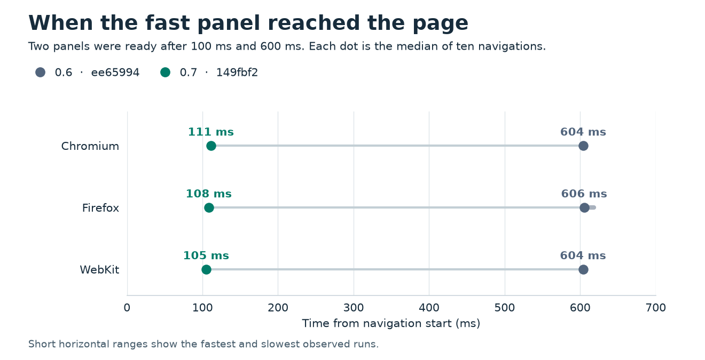
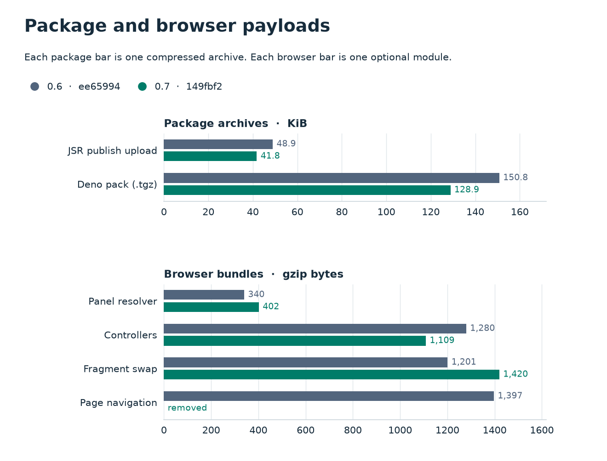
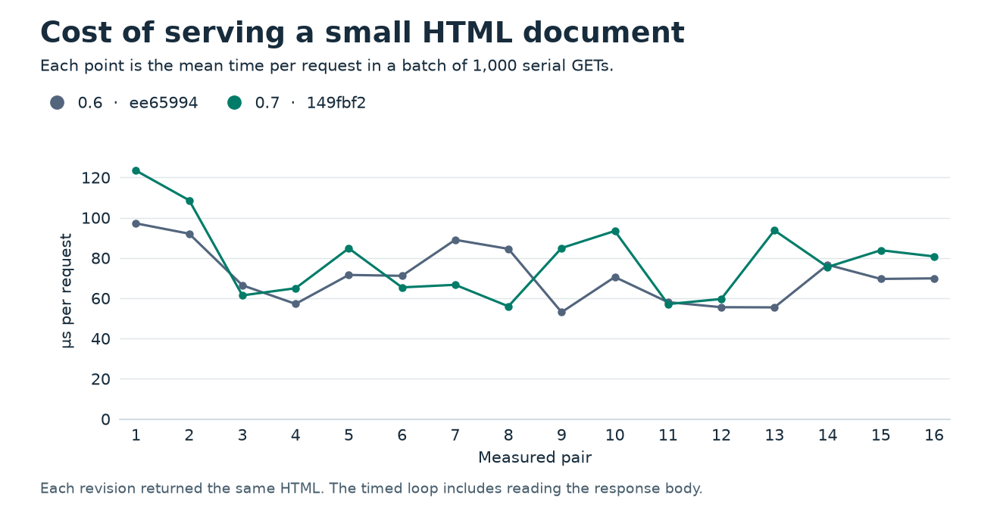

# Ruwuter 0.6 → 0.7 benchmarks

The fast panel reached the live document **493–499 ms earlier** across three browser engines when a
second panel took 600 ms. The compressed JSR publish archive shrank **14.7%**. The optional resolver
and fragment-swap modules both grew.

## Streaming latency



Each cell shows the 0.6 median → 0.7 median, in milliseconds from navigation start. The shell is the
page heading. The fast and slow panels are independent components whose work takes 100 and 600 ms. A
mutation observer records the first time each element is in the document and has a layout box.
Browser paint and input latency are outside this measurement.

| Browser               |  Shell (ms) | Fast panel (ms) | Slow panel (ms) | Fast panel range, 0.6 → 0.7 (ms) |
| --------------------- | ----------: | --------------: | --------------: | -------------------------------: |
| Chromium 159.0.8154.6 | 11.2 → 11.5 |   604.3 → 111.3 |   604.3 → 603.3 |            603–605.2 → 109–112.9 |
| Firefox 159.0         |     32 → 31 |   605.5 → 108.5 |     605.5 → 605 |                604–618 → 107–111 |
| WebKit 27.2           |     12 → 11 |       604 → 105 |       604 → 603 |                603–605 → 105–107 |

Both revisions served their own router, JSX renderer and resolver over localhost. The 0.6 fixture
uses the documented provider and head module script. The 0.7 fixture lets the router insert its
resolver when a panel settles. Both pages include the same 5 KiB product description so the parser
can show the shell while content is pending. Each engine warmed up with two pairs, then ran ten
measured pairs. Pair order alternated and every navigation used a fresh browser context with an
empty HTTP cache.

## Package and page payload



| Package measurement                        | 0.6 (bytes) | 0.7 (bytes) |           Change |
| ------------------------------------------ | ----------: | ----------: | ---------------: |
| JSR publish upload, gzip archive           |      50,116 |      42,772 |  -7,344 (-14.7%) |
| Files selected for JSR publish, on disk    |     186,776 |     152,786 | -33,990 (-18.2%) |
| npm-compatible archive from `deno pack`    |     154,442 |     131,950 | -22,492 (-14.6%) |
| Files inside that archive, unpacked        |     509,305 |     420,365 | -88,940 (-17.5%) |
| npm-compatible archive without source maps |      46,901 |      40,650 |  -6,251 (-13.3%) |

Deno reported the JSR upload size in its publish dry run. The manifest selected 33 source and
metadata files in 0.6 and 36 in 0.7. The npm-compatible numbers come from packing locally with Deno.
The default pack includes inline source maps with checkout paths, so repeat builds can vary slightly
in bytes. Deno reported 10 and 12 internal modules respectively for which it omitted generated
declarations. All sizes exclude dependencies, registry metadata and protocol headers.

| Optional browser module | 0.6 minified / gzip (B) | 0.7 minified / gzip (B) | Gzip change (B) |
| ----------------------- | ----------------------: | ----------------------: | --------------: |
| `resolve.js`            |               478 / 340 |               631 / 402 |             +62 |
| `client.js`             |           2,850 / 1,280 |           2,489 / 1,109 |            -171 |
| `swap.js`               |           2,748 / 1,201 |           3,208 / 1,420 |            +219 |
| `navigate.js`           |           2,717 / 1,397 |                 Removed |         Removed |

The browser bundles use the same minifier and gzip implementation as the repository size budgets.
Pages select modules individually. A native link or form needs no client module. Each streamed test
navigation fetched one document and one resolver. Chromium recorded the following median
response-body bytes on the empty-cache visit.

| Streamed page            | 0.6 (bytes) | 0.7 (bytes) |        Change |
| ------------------------ | ----------: | ----------: | ------------: |
| HTML response            |       5,869 |       5,915 |   +46 (+0.8%) |
| Resolver response        |         478 |         630 | +152 (+31.8%) |
| Combined response bodies |       6,347 |       6,545 |  +198 (+3.1%) |

On this localhost fixture Chromium reported equal encoded and decoded lengths. The 0.7 router serves
the generated resolver without the bundle's trailing newline. The cold page comparison includes the
markup that makes each streamed replacement safe to apply.

## Server request cost



A second workload renders a greeting from `GET /hello/:name`. Each iteration constructs a request,
dispatches it, reads the complete body, and checks the exact same HTML and status. The 0.6 route
passes the parameter through its loader. The 0.7 handler reads it from its context. This measures
serial work inside the Deno process, with HTTP transport outside the timed loop.

| 1,000 requests per batch |          0.6 |           0.7 |
| ------------------------ | -----------: | ------------: |
| Median time per request  |      70.2 µs |       78.1 µs |
| Range of batch means     | 53.1–97.2 µs | 56.0–123.4 µs |

The median cost changed by **+11.3%** in this workload. Each implementation warmed up for four
batches before the 16 measured pairs. The order alternated within pairs. Browser timings and server
batches ran separately.

## Reproduction

Measured on AMD Ryzen 7 3800X 8-Core Processor with Deno 2.9.8, Playwright Core 1.65.1, and Linux
x86-64. The harness extracts both Git trees and installs their frozen dependencies in separate
temporary directories. Measurement and plotting run outside the published package.

```sh
deno ci
deno task browsers:install
python3 bench/compare.py ee65994 149fbf2 docs/benchmarks/results.json
# Use a Python environment with Matplotlib to redraw the figures.
python3 bench/plot.py docs/benchmarks/results.json
```

Use Python 3.12 or later. On hosts with separately installed Playwright-compatible browser builds,
set `RUWUTER_CHROMIUM_EXECUTABLE`, `RUWUTER_FIREFOX_EXECUTABLE` or `RUWUTER_WEBKIT_EXECUTABLE` to
their executable paths. The recorded run used a WebKit system-library wrapper. The
[raw measurements](results.json) include every timed navigation, server batch, per-file bundle size
and full Git commit.
