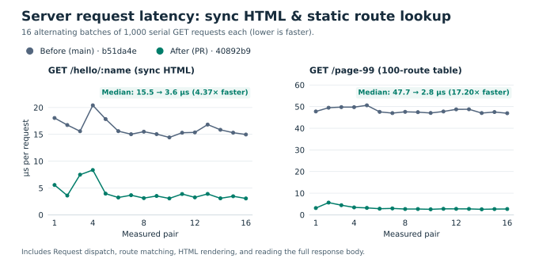
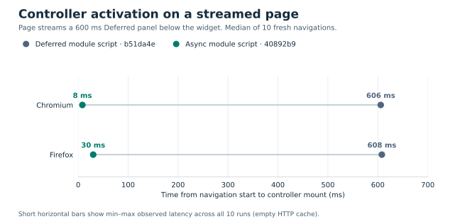
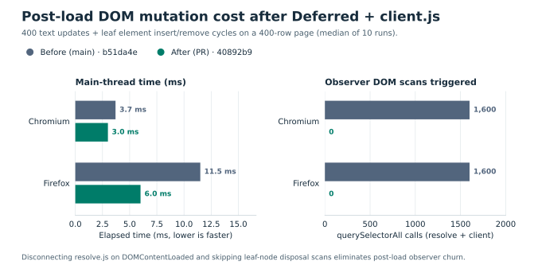

# Performance & Interactivity Benchmarks

Head-to-head comparison between `main` (`b51da4e`) and this branch (`40892b9`) across the server hot
path, streaming controller startup, and post-load DOM mutation overhead.

## 1. Server request latency



Each point is the mean time per request across a batch of 1,000 serial GETs (4 warmup pairs, 16
alternating measured pairs). Both revisions dispatched real `Request` instances and read the full
HTML response body.

| Workload                         |  `main` median (range) | Branch median (range) | Speedup |
| -------------------------------- | ---------------------: | --------------------: | ------: |
| `GET /hello/:name` (sync HTML)   | 15.5 µs (14.4–20.4 µs) |   3.6 µs (3.1–8.4 µs) |   4.37× |
| `GET /page-99` (100-route table) | 47.7 µs (46.9–50.6 µs) |   2.8 µs (2.6–5.7 µs) |  17.20× |

What changed:

- Static/synchronous `html()` trees bypass `withPanels()`, `SuspenseRegistry`, `AsyncGenerator`, and
  `ReadableStream` allocation, returning a direct `Response(string)`.
- `router()` serves leading static routes from an O(1) `Map` and matches simple `:param` routes with
  a direct segment scanner while preserving exact registration-order precedence and full
  `URLPattern` semantics (including `ignoreCase`, regex groups, and host/search constraints).
- Per-request context isolation uses a single `AsyncLocalStorage.run()` frame and `Map` allocation.

## 2. Streaming controller activation



Each page renders an above-the-fold widget followed by a 600 ms `<Deferred>` panel. Each dot is the
median of 10 alternating navigations in fresh browser contexts with an empty HTTP cache (2 warmup
pairs).

| Browser      |  Shell (ms) | `main` deferred module (ms) | Branch `async` module (ms) | Improvement |
| ------------ | ----------: | --------------------------: | -------------------------: | ----------: |
| Chromium 158 |   5.7 → 5.5 |         605.8 (605.2–607.0) |              8.3 (7.1–9.9) |   -597.5 ms |
| Firefox 157  | 25.5 → 26.0 |         608.0 (606.0–609.0) |           30.0 (28.0–32.0) |   -578.0 ms |

Loading `client.js` as `<script type="module" async>` lets above-the-fold widgets become interactive
immediately in Chromium and Firefox while slower streamed sections finish (WebKit continues to defer
`<script type="module" async>` until HTML stream close, matching the behavior noted in
[docs/router-design.md](../router-design.md)). Live scoped `refs` ensure swapped or later-settled
descendants continue to resolve cleanly.

## 3. Post-load DOM mutation overhead



After a page with a `<Deferred>` panel, a mounted controller, and 400 rows finished loading, the
benchmark performed 400 rounds of unrelated text updates plus leaf element insert/remove cycles (2
warmup pairs, 10 alternating measured pairs per engine).

| Browser  | `main` time (ms) | Branch time (ms) | Observer `querySelectorAll` calls (`main` → branch) |
| -------- | ---------------: | ---------------: | --------------------------------------------------: |
| Chromium |    3.7 (3.6–4.7) |    3.0 (2.7–3.4) |                                           1,600 → 0 |
| Firefox  | 11.5 (11.0–13.0) |    6.0 (6.0–9.0) |                                           1,600 → 0 |

What changed:

- `resolve.ts` disconnects its document-wide `MutationObserver` on `DOMContentLoaded` (and skips
  installing an observer on already-parsed documents), eliminating 800 full-document
  `template[data-rw-target]` scans.
- `client.ts` batches removal disposal into one microtask per turn, skips disposal work when no
  controllers are mounted, and avoids `querySelectorAll("[data-rw-controller]")` on removed leaf
  elements (`!root.firstElementChild`), eliminating 800 controller scans.

## Browser bundle size budgets

All optional browser runtimes remain within their existing gzip budgets:

| Module       | `main` gzip (B) | Branch gzip (B) | Budget (B) |
| ------------ | --------------: | --------------: | ---------: |
| `client.js`  |           1,204 |           1,316 |      1,400 |
| `resolve.js` |             405 |             482 |        500 |
| `swap.js`    |           1,429 |           1,442 |      1,450 |

## Reproduction

Measured on AMD Ryzen 7 7800X3D 8-Core Processor with Deno 2.9.7, Playwright Core 1.65.1, Python
3.14, and Linux x86-64 (Chromium + Firefox locally; WebKit runs in GitHub Actions CI).

```sh
python3 bench/perf-compare.py --engines=chromium,firefox main HEAD docs/benchmarks/perf-results.json
python3 bench/plot-perf.py docs/benchmarks/perf-results.json
```

Raw measurements are recorded in [perf-results.json](perf-results.json).
